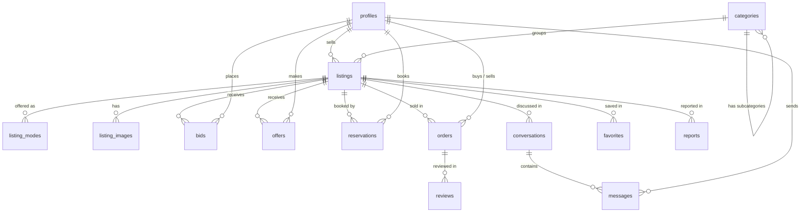

# Anston database

The schema lives in [`supabase/migrations/`](../supabase/migrations/). Run the files in order: `20261111000000_initial_schema.sql`, then `20261111020000_more_languages.sql`.

## How the tables connect

## Tables

| Table | What it stores |
| --- | --- |
| `profiles` | One row per user (created automatically at sign-up). Buyers and sellers are the same user. Holds preferred language (English, Arabic, Spanish, Chinese, French or Urdu), location, Stripe Connect account, and rating. |
| `categories` | Category tree with names in English, Arabic, Spanish, Chinese, French and Urdu, which ways to trade each allows (`allowed_modes`), whether a license is required, and the extra fields each category expects (`attribute_schema`). |
| `listings` | The item, property or service: title, description, condition, currency, location, status, and category-specific details in `attributes` (JSON). Includes full-text search. |
| `listing_modes` | How a listing is offered: `sale` (fixed price, optional offers), `auction` (start/reserve/buy-now price, end time), `rental` (rate per hour/day/week/month, deposit), `booking` (price per session). A listing can have several. |
| `listing_images` | Photo paths in Supabase Storage, in display order. |
| `bids` | Auction bids. The database rejects bids from the seller, bids below the start price or minimum increment, and bids on closed auctions. |
| `offers` | "Make an offer" on fixed-price listings, visible only to buyer and seller. |
| `reservations` | Rentals and service bookings as time ranges. The database refuses overlapping reservations for the same listing. |
| `orders` | Every completed deal of any kind, with amounts, Anston's fee and Stripe IDs. Only the server creates orders (after Stripe confirms payment). |
| `conversations`, `messages` | Buyer–seller chat, private to the two people. |
| `reviews` | One review per side per order, only after the order is fulfilled. Updates the user's rating automatically. |
| `favorites` | Listings a user saved. |
| `reports` | The "Report" button. Only admins can read and resolve reports. |

## Rules worth knowing

- **Money** is stored in minor units (cents) plus a 3-letter currency code (`USD`, `SAR`, `EUR`), so prices never have rounding errors.
- **Row Level Security** is on for every table: people can only see and change what they should (for example, a user can't edit someone else's listing or make themselves an admin).
- **Category rules** are enforced: a vehicle can't be listed as a service booking, because `vehicles` doesn't allow `booking`.
- **Homemade food** listings use `attributes.homemade = true` plus the cottage food label fields (`producer_name`, `producer_id_or_address`, `allergens`, `made_on`). The app must show these before checkout, per the Prohibited Items Policy.

## Running it

1. Create a free project at [supabase.com](https://supabase.com).
2. Open **SQL Editor**, paste the migration file, and run it. Or, with the Supabase CLI: `supabase link` then `supabase db push`.
3. Create a Storage bucket named `listing-images` for photos.
